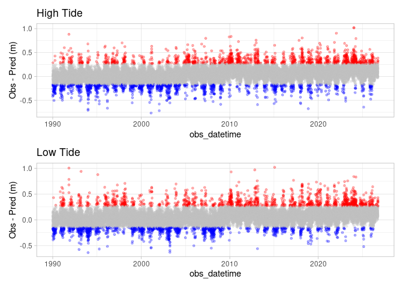

CO-OOPS
================

An R language wrapper around
[CO-OPS](https://tidesandcurrents.noaa.gov/) handy
[API](https://api.tidesandcurrents.noaa.gov/api/prod/). While throughput
is throttled, it is an easy way to gather tide and current data
including observations.

> Someday we’ll add access to the [metadata
> API](https://api.tidesandcurrents.noaa.gov/mdapi/prod/#intro)

# Requirements

- [R v4.2+](https://www.r-project.org/)
- [rlang](https://CRAN.R-project.org/package=rlang)
- [dplyr](https://CRAN.R-project.org/package=dplyr)
- [readr](https://CRAN.R-project.org/package=readr)
- [httr](https://CRAN.R-project.org/package=httr)

# Installation

    remotes::install_github("BigelowLab/coops")

# Usage

We don’t provide any information on how to use the API, we simply wrap
the API call in R for easy access. Study the [API
description](https://api.tidesandcurrents.noaa.gov/api/prod/) for
argument options. Decoding API responses is also not handled by this
package, but you can learn more about the responses
[here](https://api.tidesandcurrents.noaa.gov/api/prod/responseHelp.html).

We set the default response type to CSV (data frames), but for many
calls you can request XML or JSON.

Below is an example where request hourly tide hight for a year at the
Portland Maine (8418150) tide gage.

``` r
suppressPackageStartupMessages({
  library(coops)
  library(dplyr)
  library(patchwork)
})

x = query_coops(station = "8418150", # Portland Maine
                begin_date = as.Date("2020-01-01"),
                end_date = as.Date("2020-12-31"),
                product = "hourly_height") |>
  glimpse()
```

    ## Rows: 8,784
    ## Columns: 5
    ## $ `Date Time`   <dttm> 2020-01-01 00:00:00, 2020-01-01 01:00:00, 2020-01-01 02…
    ## $ `Water Level` <dbl> 0.984, 0.596, 0.513, 0.672, 1.084, 1.676, 2.261, 2.668, …
    ## $ Sigma         <dbl> 0.016, 0.010, 0.006, 0.012, 0.015, 0.020, 0.015, 0.009, …
    ## $ I             <dbl> 0, 0, 0, 0, 0, 0, 0, 0, 0, 0, 0, 0, 0, 0, 0, 0, 0, 0, 0,…
    ## $ L             <dbl> 0, 0, 0, 0, 0, 0, 0, 0, 0, 0, 0, 0, 0, 0, 0, 0, 0, 0, 0,…

More complex data can be obtained using `station_high_low()` which
requests observed and predicted high and low maximums. Both the observed
height and time of the tidal maximum (minimum) can be quite different
than the predicted values. We have a function that requests both
observed and predicted heights,

``` r
hilo = station_high_low(station = "8418150",
                     begin_date = as.Date("1990-01-01"),
                     end_Date = as.Date("2000-01-01")) |>
  glimpse()
```

    ## Rows: 103,588
    ## Columns: 4
    ## $ group    <chr> "obs", "pred", "pred", "obs", "pred", "obs", "obs", "pred", "…
    ## $ datetime <dttm> 1990-01-01 00:12:00, 1990-01-01 00:18:00, 1990-01-01 06:30:0…
    ## $ value    <dbl> 0.045, -0.109, 2.767, 2.940, 0.150, 0.270, 2.971, 3.037, -0.1…
    ## $ type     <chr> "L", "L", "H", "H", "L", "L", "H", "H", "L", "L", "H", "H", "…

We interpolate the high/low maxima/mimima with`station_interpolate()`
which examines the departure of the observed from the predicted.

``` r
interp_hilo = station_interpolate(hilo) |>
  glimpse()
```

    ## Rows: 51,602
    ## Columns: 7
    ## $ type          <chr> "H", "H", "H", "H", "H", "H", "H", "H", "H", "H", "H", "…
    ## $ obs_datetime  <dttm> 1990-01-01 06:30:00, 1990-01-01 18:30:00, 1990-01-02 07…
    ## $ pred_datetime <dttm> 1990-01-01 06:30:00, 1990-01-01 18:36:00, 1990-01-02 07…
    ## $ dtime         <dbl> 0, -360, 2100, 660, 720, 720, 480, 780, 60, 180, 420, 60…
    ## $ obs_value     <dbl> 2.940, 2.971, 2.413, 2.693, 2.511, 2.681, 2.928, 2.806, …
    ## $ pred_value    <dbl> 2.767, 3.037, 2.828, 2.958, 2.887, 2.856, 2.940, 2.750, …
    ## $ dvalue        <dbl> 0.173, -0.066, -0.415, -0.265, -0.376, -0.175, -0.012, 0…

And a plot…

``` r
plot_hilo(interp_hilo) |>
  wrap_plots(ncol = 1)
```

<!-- -->
